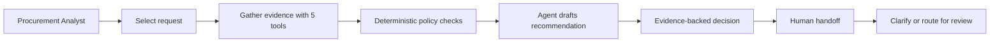

# AI Procurement Request Copilot

**FDE Assessment 3 - Nipun Patel Thumu, 24bcs10207**

A small, reliable internal product that helps a Procurement Analyst inspect a software/service request, gather evidence from five tools, apply policy rules and recommend the safest human-owned next step.

> The copilot never approves spend or purchases software. Security, Privacy, Legal, Finance and business approvals remain with people.

## The problem before the architecture

Procurement decisions are slow because the evidence is split across requests, employee records, budgets, the software catalog, purchase history, vendor records and a risk API. The harder problem is not generating an answer; it is knowing whether the evidence is complete, current and consistent enough to act.

**Primary user:** Procurement Analyst  
**Decision:** What should happen next for this request, and which humans must review it?  
**Primary KPI:** Decision-quality pass rate on a shared evaluation set.

### Assumptions and limits

- The supplied classroom snapshot is authoritative as of 30 September 2026.
- The procurement policy is the source of truth for thresholds and mandatory reviews.
- The Procurement Analyst can access the supplied internal records.
- Production request volume, review-time baseline and provider cost are unknown.
- Six synthetic evaluation cases demonstrate behaviour, not production accuracy.

## Product workflow



The UI shows request details, recommendation, evidence, required approvals, missing information, risk flags, next step, telemetry and an append-only human handoff. It also exposes both architectures for the experiment.

## Architecture and responsibility split

| Layer | Responsibility |
|---|---|
| AI | Interpret contextual fit and write a concise structured recommendation |
| Deterministic Python | Required fields, budget arithmetic, thresholds, mandatory reviews, conflicts and prompt-injection flags |
| Human | Final approval, purchasing, exceptions and specialist judgment |

### Architecture A - single-agent baseline

```text
UI -> Procurement Agent -> 5 tools + policy engine -> ProcurementDecision -> human handoff
```

One bounded model call interprets the evidence. Deterministic approvals and risks are merged afterwards and cannot be removed by model text.

### Architecture B - staged / two-agent variant

```text
UI -> Procurement Analyst Agent -> structured draft
   -> Policy/Risk Reviewer Agent -> ProcurementDecision -> human handoff
```

The reviewer gets a structured packet, performs one review pass and stops. There is no open-ended agent conversation.

## Tools

| Tool | Evidence produced | Type |
|---|---|---|
| Request context | Requester, department and request fields | Deterministic |
| Budget check | Available budget, annual cost and remaining amount | Deterministic |
| Existing software search | Exact/category overlap and purchase history | Deterministic retrieval |
| Vendor evidence | Internal registry plus external risk API | API + deterministic comparison |
| Policy engine | Missing fields, thresholds and required reviews | Deterministic |

Free text from requests and vendor notes is treated as untrusted data. Missing, stale, conflicting or unavailable evidence is surfaced and routed to a person.

## Run locally

Python 3.11 or 3.12 is recommended.

```bash
python3 -m venv .venv
source .venv/bin/activate
python3 -m pip install -r requirements.txt
cp .env.example .env
```

Add a Gemini API key to `.env`:

```text
GEMINI_API_KEY=your_key_here
MODEL_NAME=gemini-3.5-flash-lite
```

Then verify and start everything:

```bash
python3 verify_setup.py
python3 run_local.py
```

Open `http://127.0.0.1:8501`. The same launcher starts the mock vendor-risk API on port `8001`.

No API key? The system still runs in an explicit deterministic fallback mode; the UI and telemetry label that limitation.

## Evaluation

Run the supplied minimum checks on both architectures:

```bash
python3 evals/run_public_evals.py --architecture single
python3 evals/run_public_evals.py --architecture staged
```

Run the additional quality comparison:

```bash
python3 evals/run_quality_eval.py
```

The quality evaluator scores four criteria per case: correct next action, grounded evidence, policy compliance and correct human escalation.

| Metric | Single agent | Staged / 2-agent |
|---|---:|---:|
| Cases passing all criteria | 6/6 | 6/6 |
| Quality checks | 24/24 | 24/24 |
| Average latency | 1.53 s | 2.03 s |
| Average LLM calls | 1.0 | 1.7 |
| Average tool calls | 5.0 | 5.0 |
| Policy / grounding failures | 0 | 0 |

Results from the measured run are saved in [`evals/evaluation_results.csv`](evals/evaluation_results.csv). Automated tests cover budget logic, approval bands, missing fields, sensitive access, conflicting evidence, prompt injection, vendor API failure and human handoff.

```bash
python3 -m unittest discover -s tests -v
```

Current result: **20/20 tests pass** and `verify_setup.py` reports **PRE-FLIGHT PASSED**.

## Ship decision

I would ship the **single-agent MVP**. Both designs achieved the same quality score, while staging was about 33% slower and introduced an additional model dependency. The policy engine already provides the independent safety boundary that matters for this workflow. The staged design remains available as an experiment and can be promoted only if broader, more ambiguous cases demonstrate a measurable quality gain.

See [`docs/architecture_decision.md`](docs/architecture_decision.md) for the evidence-backed decision memo.

## Known limitations

- Six synthetic public cases do not represent production traffic.
- Semantic overlap detection is intentionally lightweight.
- Data sources are a static classroom snapshot dated 2026-09-30.
- Human handoffs use a local append-only JSONL file, not a production workflow platform.
- Production use would require authentication, authorization, durable audit storage, monitoring and real enterprise integrations.
- Model latency, quota and availability depend on the provider; deterministic fallback preserves safe routing.

## Repository map

```text
app.py                         Streamlit product UI
run_local.py                   One-command local launcher
src/agents.py                  Single and staged agent flows
src/tools.py                   Evidence tools
src/policy_engine.py           Deterministic safety controls
src/llm_client.py              Gemini boundary + safe fallback
src/solution.py                Stable evaluation adapter
evals/run_quality_eval.py      Reproducible architecture comparison
docs/architecture_decision.md  Evidence-backed ship decision
tests/                         Integrity, API and solution tests
```

All business data in this repository is synthetic and supplied for the assessment.
